## **Filtros de Suavização (Passa-Baixa)**

-> Os filtros são de grande importância na visão computacional, pois quando adquirimos uma base de dados visual, muitas vezes, pode apresentar **ruído**; e para evitar erros devido à presença desse ruído, aplicamos diversos tipos de filtros para minimizar ao máximo o distúrbio que podem causar no resultado final. Esses filtros são chamados de **Passa-Baixa** ou **Filtros de Suavização**.

-> Esse repositório apresenta a aplicação manual (no arquivo `simple_filt.py`) do filtro de média e do filtro de mediana, ambos muito conhecidos:

  * **Filtro de média:** Substitui cada pixel da imagem pela média dos valores dos pixels vizinhos.
      * **Efeito:** Remove detalhes finos e pequenas texturas, resultando em uma imagem mais suave/embaçada.
  * **Filtro de mediana:** Substitui cada pixel pelo valor mediano dos pixels em sua vizinhança.
      * **Efeito:** Remove ruído sal e pimenta (pontos brancos/preto isolados).

    
    
    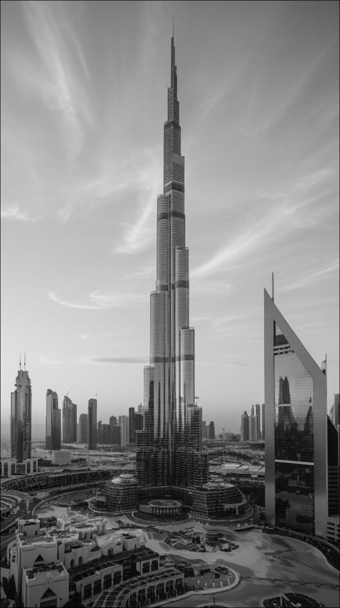

* Essas três imagens PARECEM iguais, devido ao tamanho do filtro usado ter sido pequeno, mas ao abrir em seu próprio computador, irão apresentar um leve **BLUR**.

---

## **Detecção de Bordas (Filtros de Realce/Passa-Alta)**

-> A detecção de bordas utiliza métodos matemáticos para identificar pontos em uma imagem onde há uma **mudança significativa na luminosidade** das intensidades dos pixels.

    
    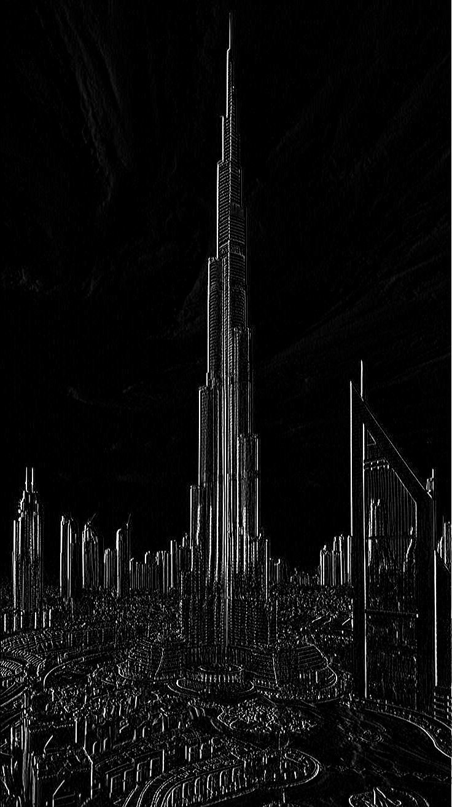
    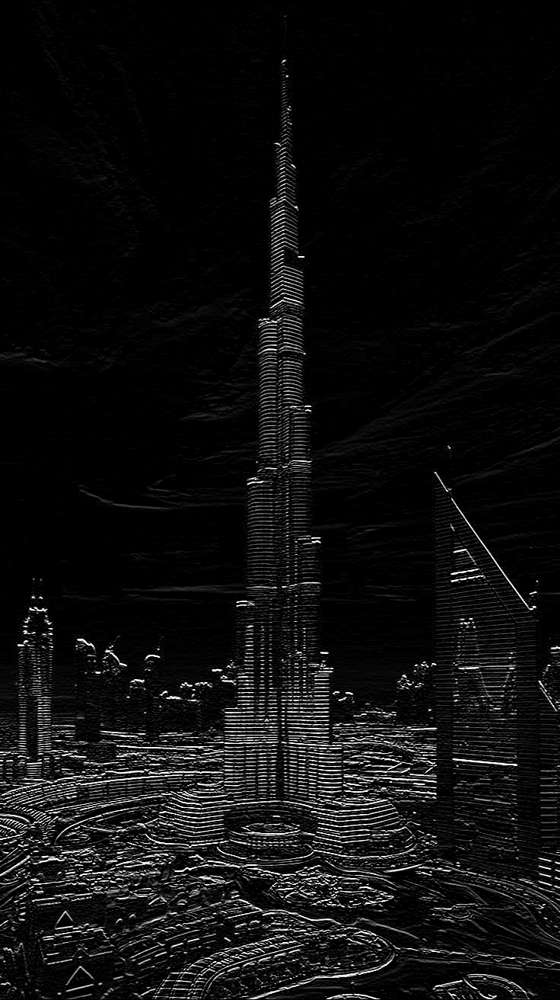

-> Os filtros de realce (também chamados de **Passa-Alta** ou de **Filtros de Gradiente**) enfatizam as regiões de bordas e os ruídos, e não enfatizam regiões constantes ou com variações de intensidade suaves.

-> O arquivo `detec_board.py` demonstra a aplicação de um **filtro de gradiente na direção horizontal** (que realça bordas verticais), um tipo de filtro de primeira derivada:

  * **Filtros de Primeira Derivada (Gradiente):** Baseiam-se na primeira derivada espacial da imagem para encontrar bordas.

      * **Exemplos Comuns:** Operadores de **Sobel** e Prewitt. O operador de Sobel utiliza dois *kernels* (máscaras) para calcular as derivadas parciais nas direções $x$ e $y$ (horizontal e vertical), permitindo encontrar bordas em ambas as direções. O gradiente resultante representa a magnitude e a direção das bordas.

  * **Filtros de Segunda Derivada:** Utilizam a segunda derivada espacial da imagem.

      * **Exemplos Comuns:** Operador **Laplaciano**. O Laplaciano é uma medida isotrópica bidimensional da derivada de segunda ordem. Ele realça transições abruptas de intensidade, como bordas, mas é sensível ao ruído e é frequentemente usado em conjunto com técnicas de suavização (como no Laplaciano do Gaussiano - LoG). O Laplaciano é geralmente mais rápido de ser computado que o Sobel.

O filtro implementado em `detec_board.py` usa o seguinte *kernel* (componente $G_x$: mede a variação na horizontal, por isso enfatiza bordas verticais):

    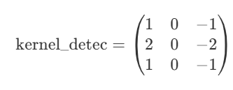

* Este *kernel* corresponde ao filtro de Sobel na direção $x$.

* A demonstração em `detec_board.py` compara a aplicação do filtro usando a função `cv2.filter2D` e uma implementação manual com *loop* e *padding*. A implementação manual inclui a conversão para `np.int16` para permitir valores negativos do gradiente (diferença) antes do *clip* e conversão final para `np.uint8`.

---

## **Magnitude do Gradiente (Sobel em x e y)**

-> Um único *kernel* de Sobel só enxerga **uma direção**. O $G_x$ responde a variações na horizontal e quase ignora linhas horizontais; o $G_y$ faz o oposto. Para ter o mapa de bordas completo, precisamos juntar os dois, e é isso que o arquivo `magnitude.py` faz.

    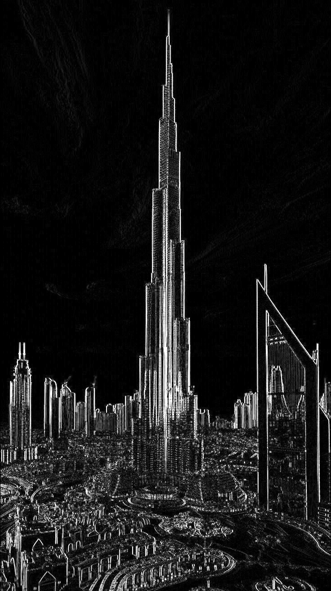
    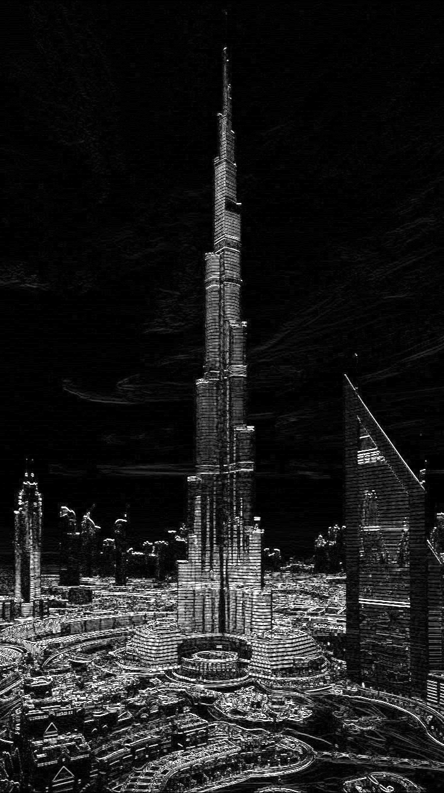
    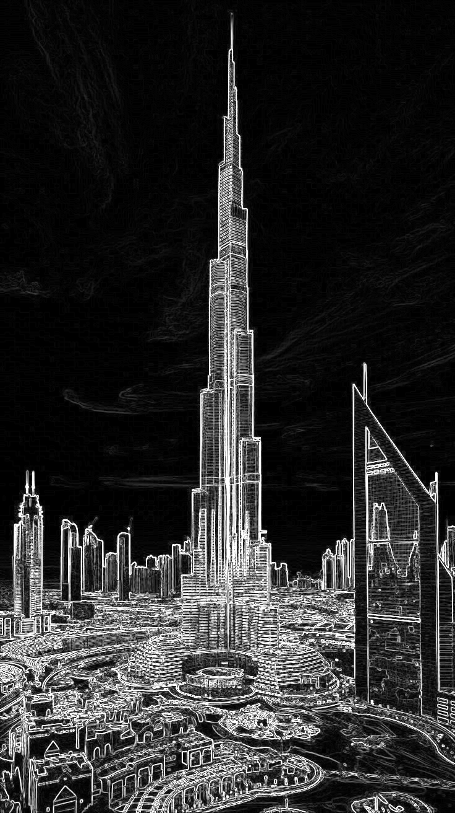

<i>Gx, Gy e magnitude, calculados na mesma foto.</i>

### 🔹 Como ler as imagens

* $G_x$ = variação **na horizontal** (esquerda → direita) → destaca as bordas **verticais** (as laterais dos prédios).
* $G_y$ = variação **na vertical** (cima → baixo) → destaca as bordas **horizontais** (os andares, o topo dos telhados).
* **Magnitude** = combinação dos dois: aparecem as bordas de todas as orientações, inclusive as diagonais, que ficam em parte em cada um.

### 🔹 O gradiente é um vetor

Em cada pixel, os dois *kernels* dão dois números, $(G_x, G_y)$. Juntos eles formam um **vetor**, uma seta que aponta na direção em que a intensidade **muda mais rápido** (o sinal depende do sentido do *kernel*; aqui, como o `filter2D` faz correlação, ele aponta para o lado que escurece). Esse vetor tem:

* **comprimento** $|G|$: quão forte é a borda ali;
* **direção** $\theta$: para que lado a borda "aponta" (a borda em si fica perpendicular a essa seta).

    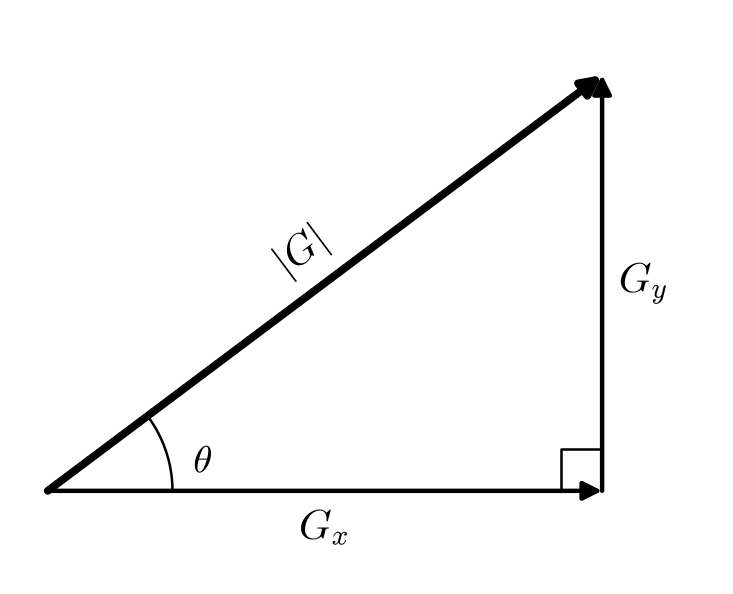

Pense em andar 4 m para o leste ($G_x$) e 3 m para o norte ($G_y$): você andou 5 m em linha reta. $G_x$ e $G_y$ são os dois catetos, e a magnitude é a hipotenusa (Pitágoras).

### 🔹 Cálculo (Definição Matemática)

$$|G| = \sqrt{G_x^2 + G_y^2}$$

* **Em uma frase:** o comprimento do vetor gradiente, ou seja, a **força da borda em qualquer direção**.
* Pixel em região uniforme: $G_x \approx G_y \approx 0$, então $|G| \approx 0$ (preto).
* Pixel em borda forte: pelo menos um dos dois é grande, então $|G|$ é grande (branco).

A direção, que o `magnitude.py` não calcula, seria:

$$\theta = \operatorname{atan2}(G_y,\ G_x)$$

O detector de bordas de **Canny** usa essa magnitude e depois essa orientação para afinar as bordas.

### 🔹 Aplicação em Imagens (`magnitude.py`)

* **Dois *kernels* de Sobel:** o mesmo *kernel* mostrado na seção anterior para $G_x$, e sua versão transposta para $G_y$.
* **Por que `cv2.CV_16S`:** o gradiente pode ser **negativo** (a intensidade muda no sentido oposto ao do positivo, por exemplo escuro → claro em vez de claro → escuro), e isso **também é borda**. Com saída `uint8`, o `filter2D` zera os negativos e perde metade das bordas. Com `CV_16S` o sinal é preservado até a conta da magnitude (por isso o `filter2D` aqui usa `CV_16S`, e não o tipo da imagem como em `detec_board.py`).
* **Magnitude em `float32`:** os valores são elevados ao quadrado, então a conversão evita estouro do `int16` (um $|G_x|$ pode chegar a 1020 e  milhão, muito acima de 32767).
* **Exibição:** `np.abs` + `np.clip(0, 255)` só para mostrar; valores acima de 255 saturam em branco, então bordas muito fortes ficam todas iguais. Na magnitude o `abs` não é necessário, porque ela já é $\geq 0$.
* Para salvar as imagens, descomente os `imwrite` em `img/magnitude/`.

---

## **Manipulação de Gama (Correção de Gama)**

A **manipulação de gama**, ou **correção de gama**, é uma técnica fundamental no processamento de imagens usada para ajustar a **luminosidade não linear** dos pixels. Câmeras, sensores e monitores possuem respostas luminosas diferentes, e a correção de gama serve para compensar essas variações e **melhorar o contraste perceptível** da imagem.

-> **Compreendendo o efeito do gama**

O gráfico abaixo mostra como o valor de saída (eixo Y) se relaciona ao valor de entrada (eixo X) para diferentes valores de \( \gamma \):

    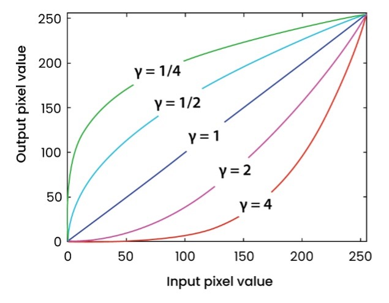

-> **Interpretação:**
- Curvas **côncavas** (γ < 1) — *clareiam* a imagem, realçando detalhes em regiões escuras.  
- Curvas **lineares** (γ = 1) — mantêm a imagem original.  
- Curvas **convexas** (γ > 1) — *escurecem* a imagem, realçando detalhes em áreas claras.

Essas transformações permitem **controlar o contraste dinâmico** e adaptar a imagem à forma como o olho humano percebe a luz.

-> **Importância da Correção de Gama**

Ajustar o gama é essencial em diversas áreas:

-  **Melhora o contraste dinâmico:** Gamas menores (< 1) tornam a imagem mais clara, evidenciando detalhes em sombras.  

-  **Realça regiões escuras ou claras:** Gamas maiores (> 1) tornam a imagem mais escura, evitando o “lavado” causado por brilho excessivo.  

-  **Correção de exibição:** Essencial para calibrar imagens exibidas em diferentes telas, evitando distorções de luminosidade.  

-  **Visão computacional e machine learning:** Usado como pré-processamento para melhorar o reconhecimento de padrões e objetos sob diferentes condições de iluminação.

    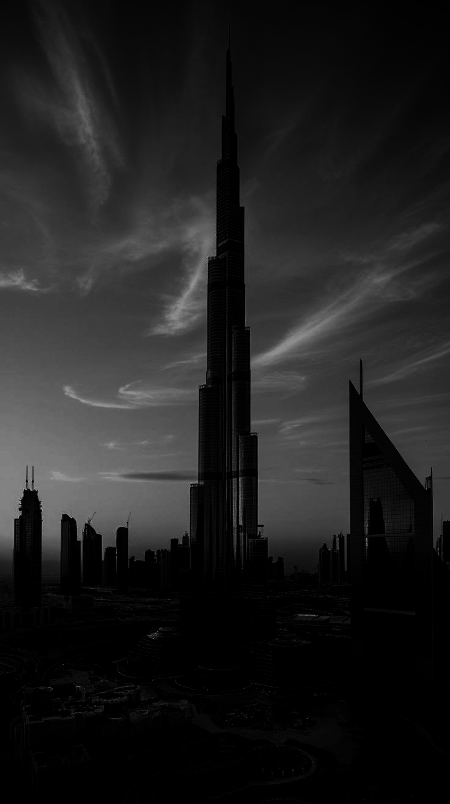
    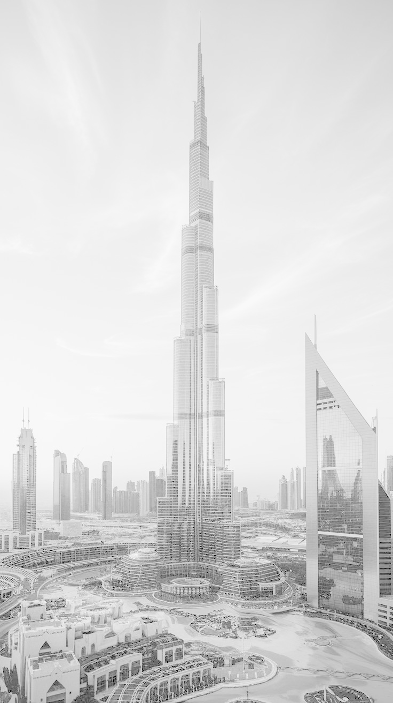
    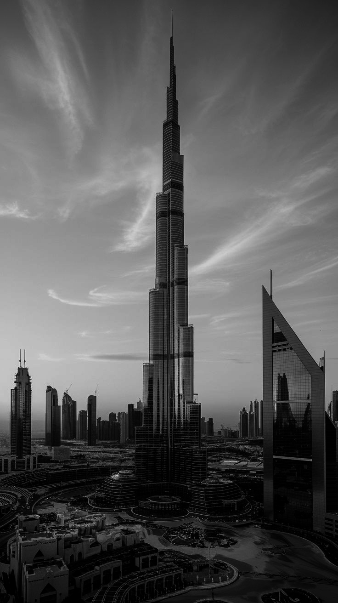
    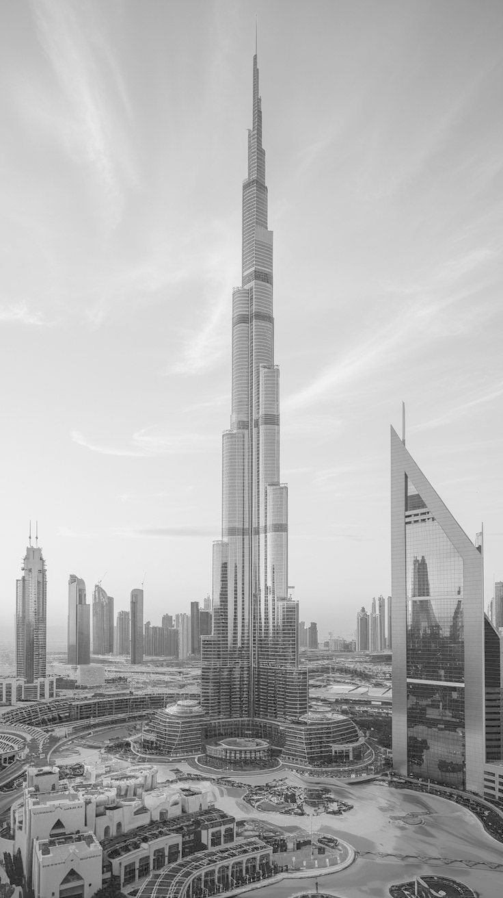

---

## **Equalização de Histograma**

-> A *equalização de histograma* é uma técnica fundamental no processamento de imagens usada para melhorar o contraste global de uma imagem. Ela é particularmente útil para imagens que parecem "lavadas" ou que estão sub/superexpostas, onde os pixels estão concentrados em uma faixa muito estreita de intensidades.

-> O objetivo principal é *redistribuir as intensidades dos pixels* de forma mais uniforme por toda a faixa dinâmica (normalmente de 0 a 255 em escala de cinza). Isso é alcançado "esticando" o histograma da imagem.

-> Essencialmente, a técnica tenta mapear os níveis de cinza da imagem de entrada para que o histograma da imagem de saída seja o mais plano possível. Isso é feito usando a *Função de Distribuição Acumulada* (CDF) do histograma original como a função de mapeamento.

-> O script `equalization.py` demonstra a implementação manual desse processo, calculando o histograma, depois a CDF, e usando-a para mapear os valores de pixel antigos para novos valores.

  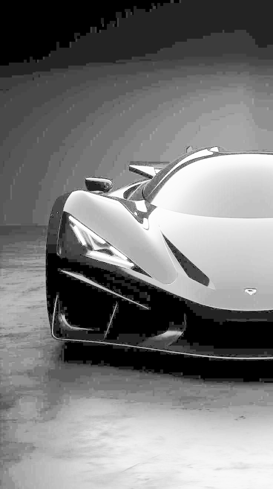 

Acima, a imagem da esquerda é a original, que possui baixo contraste e parece "acinzentada". A imagem da direita é o resultado após a equalização, onde os detalhes estão muito mais nítidos e o contraste foi significativamente melhorado.

-> A diferença no "espalhamento" dos pixels fica evidente ao comparar os histogramas das duas imagens:

 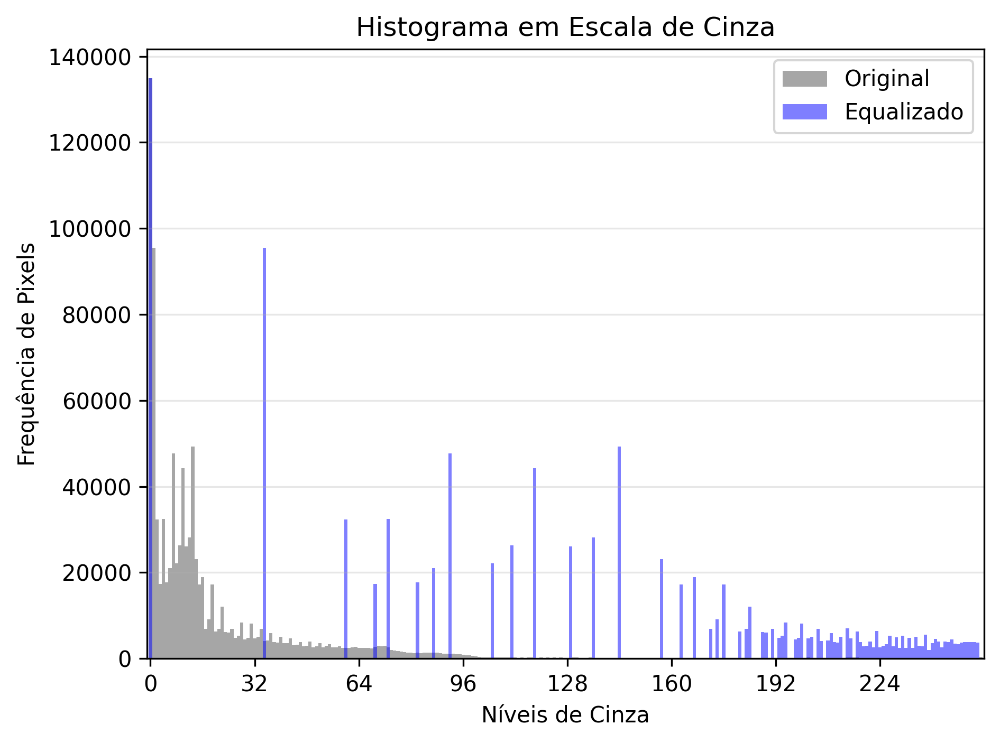 

No gráfico, o histograma Original (em cinza) mostra que a grande maioria dos pixels está condensada em uma faixa estreita no meio do espectro.

Após a equalização, o histograma Equalizado (em azul) mostra que as frequências dos pixels foram redistribuídas por uma faixa muito mais ampla de intensidades, confirmando o aumento do contraste dinâmico.

---

## Conversão de RGB para HSV e Equalização Baseada em Brilho

O espaço de cor HSV (Hue, Saturation, Value) é uma representação alternativa do modelo RGB, onde a informação de cor e luminosidade são separadas.
Enquanto no modelo RGB os três canais (vermelho, verde e azul) combinam cor e intensidade, no modelo HSV:

* **H (Hue / Matiz):** representa o tipo de cor (ângulo de 0° a 360° na roda de cores);
* **S (Saturation / Saturação):** indica o quão "pura" ou intensa é a cor;
* **V (Value / Brilho):** representa o nível de luminosidade.

Essa separação é extremamente útil em visão computacional, pois permite manipular apenas o brilho (V) sem alterar a coloração natural da imagem.

### 🔹 Conversão Manual de RGB → HSV

O arquivo `convertRGBtoHSV.py` demonstra o processo de conversão manual entre os espaços de cor.
Cada pixel RGB é convertido para HSV por meio das seguintes etapas:

1.  Normalização dos valores RGB: cada canal é dividido por 255.
2.  Cálculo dos valores máximo ($\text{max}$) e mínimo ($\text{min}$) entre (R, G, B).
3.  Determinação de $\Delta = \text{max} - \text{min}$ para definir o matiz (H).
4.  Cálculo dos componentes (ou variações conforme o canal dominante):

    $$H = 60 \times \left( \frac{g-b}{\Delta} \right)$$ 
    $$S = \frac{\Delta}{\max(R,G,B)}$$
    $$V = \max(R,G,B)$$

Após o cálculo, os valores são ajustados para o formato usado pelo OpenCV:

* $H \in [0, 180]$
* $S, V \in [0, 255]$

### 🔹 Equalização no Canal V (Brilho)

A equalização de histograma é mais eficiente quando aplicada no canal V do modelo HSV, pois ela atua diretamente sobre o brilho da imagem — sem distorcer cores ou tons.

O processo é o seguinte:

1.  Converter a imagem RGB para HSV.
2.  Separar os canais H, S e V.
3.  Aplicar a equalização **somente em V**.
4.  Reunir novamente os três canais (H, S, V).
5.  Converter de volta para RGB para exibição.

  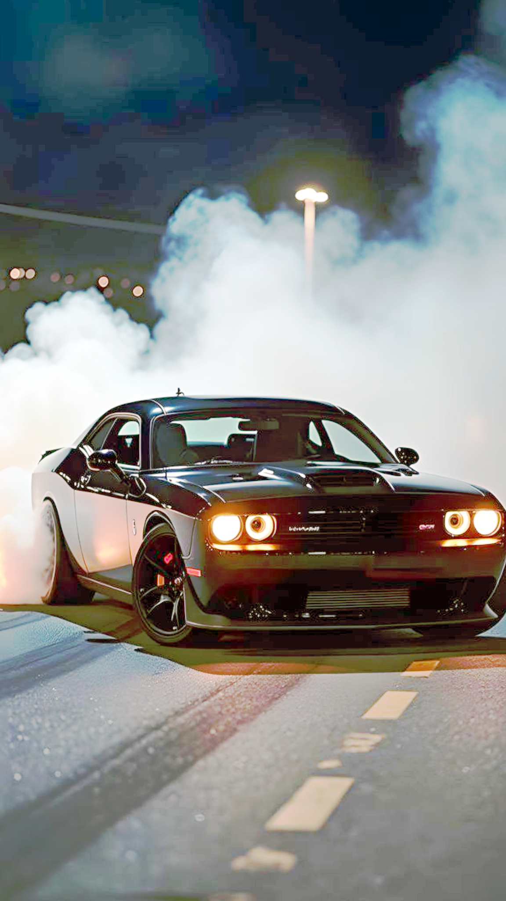 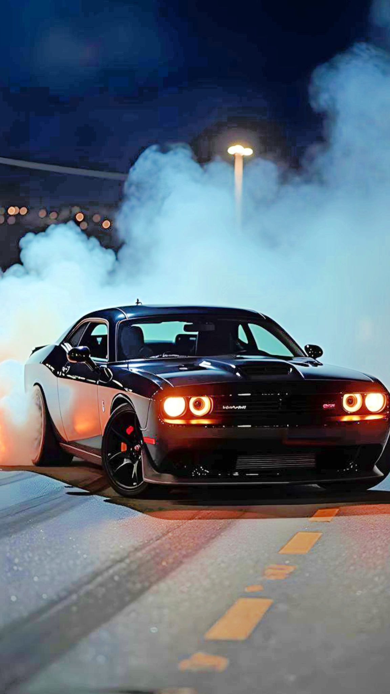 

A primeira imagem é a fotografia original (retirada do pinterest!)
A segunda imagem mostra a equalização feita **diretamente em RGB** — que tende a alterar as cores originais.
A terceita mostra a **equalização via HSV**, preservando tons e aumentando o contraste de forma mais natural.

### 🔹 Importância do HSV para Equalização

* **Evita distorções de cor** causadas pela equalização independente de R, G e B.
* **Melhora o contraste percebido** sem alterar a aparência geral.
* **Facilita o pré-processamento** em visão computacional, tornando a imagem mais uniforme para algoritmos de segmentação e detecção.
* É amplamente usada em aplicações como realce de imagens médicas, processamento de vídeos e análise de cenas com iluminação variável.

---

## **Índice de Jaccard (Métrica de Similaridade)**

-> O **Índice de Jaccard**, também conhecido como *Jaccard Similarity Coefficient* ou *Intersection over Union (IoU)*, é uma métrica fundamental utilizada para medir a **similaridade** entre dois conjuntos de dados. Seu valor varia de **0 a 1**, onde 0 indica nenhuma similaridade e 1 indica que os conjuntos são idênticos.

-> É amplamente utilizado em diversas áreas, e, no contexto de **Visão Computacional**, é uma métrica crucial para a **avaliação de métodos de segmentação de imagens**.

### 🔹 Cálculo (Definição Matemática)

Matematicamente, o Índice de Jaccard ($J$) é definido como a razão entre o tamanho da **interseção** dos conjuntos e o tamanho da **união** dos conjuntos.

$$J(A, B) = \frac{|A \cap B|}{|A \cup B|}$$

No contexto de classificação binária (como em segmentação de imagens), a fórmula pode ser reescrita usando a matriz de confusão:

$$J = \frac{TP}{TP + FP + FN}$$

### 🔹 Aplicação em Imagens (`jaccard.py`)

O arquivo `jaccard.py` implementa uma variação simples do cálculo de similaridade entre duas imagens em escala de cinza, comparando a intensidade de seus pixels.

* **Conversão para Escala de Cinza (Gray):** As imagens de entrada RGB são convertidas para escala de cinza, onde cada pixel é representado por uma única intensidade.
* **Cálculo de Similaridade (Variação Simples):** Em vez de usar a intersecção/união binária estrita (o uso mais comum para IoU), o código considera dois pixels (de imagens diferentes na mesma posição) como "semelhantes" se suas intensidades estiverem dentro de um limiar de **±10%**:
    * `foto1_gray[i, j] >= foto2_gray[i, j]*0.9`
    * `foto1_gray[i, j] <= foto2_gray[i, j]*1.1`
* **Índice de Jaccard (Implementação):** O valor do `jaccard_index` é calculado pela razão entre o número total de pixels semelhantes (`soma`) e o número total de pixels na área de sobreposição (`altura * largura`).

Esta implementação adapta a ideia de similaridade de Jaccard para pixels em escala de cinza, onde o coeficiente representa a **proporção de pixels** que são *aproximadamente* iguais entre as duas imagens.

---

## **Limiarização (Thresholding) e Binarização**

A **limiarização** é uma das técnicas de segmentação mais simples e eficazes no processamento digital de imagens. Seu objetivo é converter uma imagem em escala de cinza em uma **imagem binária** (preto e branco), criando uma separação clara entre as regiões de interesse (objeto) e o fundo (background).

O processo consiste em definir um valor de intensidade de cinza, chamado de **limiar ($T$)**, para separar os pixels:
* Pixels com intensidade **acima** do limiar ($> T$) são definidos como um valor (geralmente branco/255).
* Pixels com intensidade **abaixo ou igual** ao limiar ($\le T$) são definidos como o valor oposto (geralmente preto/0).

O arquivo `limiarizaçao.py` demonstra a aplicação de um **Limiar Global Fixo** (T=128), onde o mesmo valor de limiar é aplicado a toda a imagem.

O desafio principal da limiarização é determinar o **valor ideal de $T$**. Uma análise do **histograma** da imagem é crucial, pois ele pode indicar padrões e o contraste, facilitando a escolha de um bom limiar.

### Algoritmo de Otsu (Limiarização Automática)

O método de **Otsu**, proposto por Nobuyuki Otsu em 1979, é um dos algoritmos de limiarização mais populares. Ele é classificado como um método de **limiarização global automática**.

#### **Conceito Principal**

O algoritmo assume que o histograma de uma imagem pode ser dividido em duas classes (grupos): o **objeto (foreground)** e o **fundo (background)**.

A meta de Otsu é **determinar o valor de limiar ($T$)** que melhor separa essas duas classes no histograma, buscando:
1.  **Minimizar a variância interna das classes** (variância intraclasse).
2.  **Maximizar a variância entre as classes** (variância interclasse).

#### **Funcionamento**

1.  O algoritmo itera sobre **todos os 256 possíveis valores de intensidade** ($t$) para o limiar.
2.  Para cada $t$, ele calcula as probabilidades de ocorrência (pesos, $\omega$) e as médias de intensidade ($\mu$) das duas classes formadas (pixels $\le t$ e pixels $> t$).
3.  Utilizando estas métricas, ele calcula a **variância entre classes** ($\sigma_b^2(t)$):
    $$\sigma_b^2(t) = \frac{(\mu_t \omega(t) - \mu(t))^2}{\omega(t) (1 - \omega(t))}$$
    *Essa é a fórmula central utilizada no arquivo `limiarização_otsu.py`.*
4.  O **Limiar de Otsu** ideal é o valor de $t$ que **maximiza** o valor de $\sigma_b^2(t)$.

O arquivo `limiarização_otsu.py` demonstra a implementação manual deste algoritmo, encontrando o limiar ótimo para binarizar a imagem. Este método é especialmente útil quando a imagem possui **iluminação uniforme e bom contraste** entre o objeto e o fundo.

 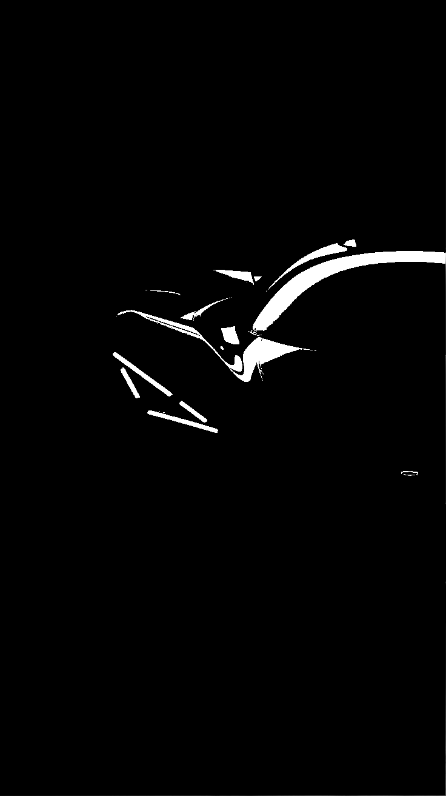 &nbsp;&nbsp;&nbsp;&nbsp;&nbsp;&nbsp; 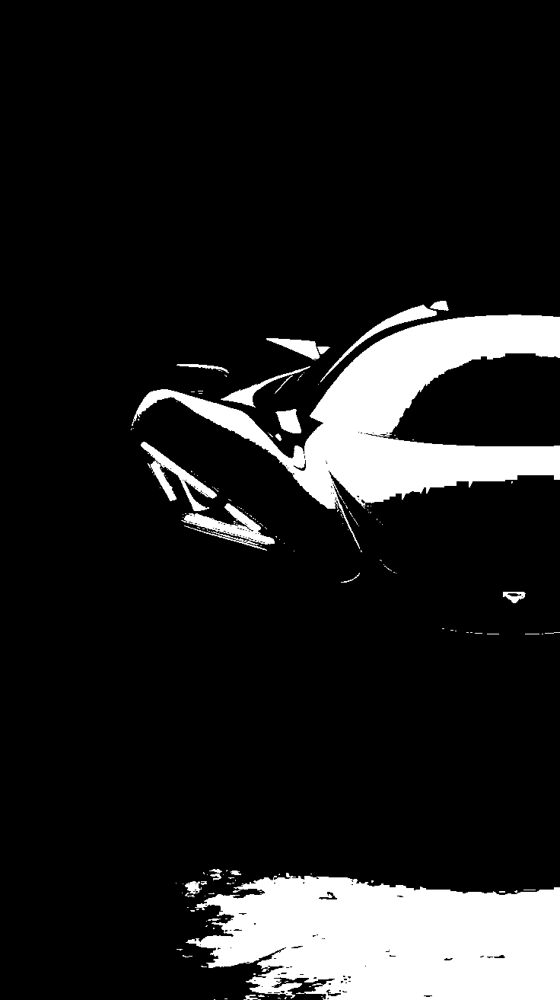 
 
 À esquerda: Limiarização Fixo (T=128). | À direita: Limiarização por Otsu (Limiar Automático). 
